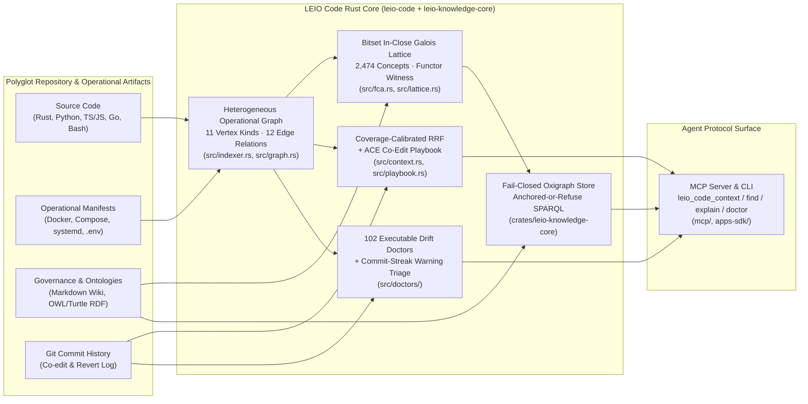

# Beyond the Call Graph: Infrastructure-Aware Code Graphs, Formal Concept Lattices, and Executable Drift Contracts for Coding Agents

**Venue Target:** IEEE/ACM ICSE / ESEC/FSE / ASE  
**LaTeX Source:** [`papers/leio-code-icse/main.tex`](main.tex)  
**Reproducible Benchmark Runner:** [`scripts/benchmark_paper_ablations.py`](../../scripts/benchmark_paper_ablations.py)  
**Evaluation Artifacts:** [`benchmarks/paper-evaluation-suite.json`](../../benchmarks/paper-evaluation-suite.json), [`benchmarks/paper-ablation-results.json`](../../benchmarks/paper-ablation-results.json), [`benchmarks/retrieval-agent-results.json`](../../benchmarks/retrieval-agent-results.json)

---

## Abstract

Repository-level coding agents spend $60\text{--}80\%$ of their interaction turns and token budgets executing iterative lexical searches (`grep`/`rg`) and partial file reads to reconstruct software architecture. Existing repository indexing tools—such as AST symbol maps (RepoMap) and Language Server Protocol (LSP) call graphs—capture intra-language syntax but are structurally blind to *operational topology*: environment variable contracts across code and deployment manifests, Redis key namespace lifecycles, HTTP/MCP route tables, Docker and systemd service wiring, and cross-language subprocess boundaries. Furthermore, when combining lexical, structural, and configuration retrieval signals, we show that naive multi-channel Reciprocal Rank Fusion (RRF) suffers from *single-token channel amplification*, where monolithic "god files" and test fixtures outrank cohesive implementation modules.

We present **LEIO Code** (`v2.6.5`), a deterministic, sub-second repository intelligence engine implemented in Rust that unifies AST call/import graphs, operational infrastructure topology, Formal Concept Analysis (FCA) Galois lattices, fail-closed Oxigraph SPARQL grounding, and 102 executable architectural drift contracts (*doctors*) behind a versioned JSON and Model Context Protocol (MCP) surface. To rank task-relevant context bundles accurately in a single call, we introduce **Coverage-Calibrated Multi-Faceted RRF** augmented with an evolving Git co-edit playbook (**ACE**). Evaluated on our 349-file polyglot repository ($8,343$ formal objects, $4,061$ attributes, $67,642$ structural incidences, and $2,474$ closed Galois concepts induced in $593\,\text{ms}$), LEIO Code achieves $\text{MRR} = 0.9800$, $\text{Hit@1} = 96.0\%$, and $\text{Hit@3} = 100.0\%$ across a 25-task multi-category benchmark, outperforming lexical `ripgrep` ($\text{MRR} = 0.3193$, $\text{Hit@1} = 20.0\%$), AST-only RepoMap ($\text{MRR} = 0.7367$, $\text{Hit@1} = 68.0\%$), and naive 3-layer RRF ($\text{MRR} = 0.6847$, $\text{Hit@1} = 52.0\%$), while reducing localization token consumption by **$29.4\times$** ($17,261 \to 587$ tokens) and agent tool calls by **$3.45\times$**. On coupled cross-layer edits, the ACE co-edit playbook lifts unindexed manifest/documentation partner recall ($\text{Recall@6}$) from $16.7\%$ to $100.0\%$.

---

## 1. System Architecture

---

## 2. Formal Foundations

### 2.1 Heterogeneous Operational Repository Graph ([`src/indexer.rs`](../../src/indexer.rs), [`src/graph.rs`](../../src/graph.rs))

Unlike AST-only graphs where $\mathcal{K}_V = \{\texttt{File}, \texttt{Symbol}\}$, LEIO Code defines a typed, directed multigraph $\mathcal{G} = (V, E, \tau_V, \tau_E, \lambda)$ over 11 vertex domains:

$$\mathcal{K}_V = \{\texttt{File},\; \texttt{Symbol},\; \texttt{Import},\; \texttt{EnvVar},\; \texttt{RedisKey},\; \texttt{ApiRoute},\; \texttt{DockerService},\; \texttt{DeployTarget},\; \texttt{Cartridge},\; \texttt{SubprocessCaller},\; \texttt{Binary},\; \texttt{WikiSection}\}$$

and cross-layer operational edges including $\texttt{ReadsEnv}$, $\texttt{DeclaresEnv}$, $\texttt{ReadsRedisKey}$, $\texttt{WritesRedisKey}$, $\texttt{SetsTtl}$, $\texttt{ExposesRoute}$, $\texttt{SpawnsBinary}$, and workspace-resolved module edges $\texttt{ResolvedImports}$.

### 2.2 Bitset `In-Close` Galois Concept Lattice & Functor Coherence ([`src/fca.rs`](../../src/fca.rs), [`src/category.rs`](../../src/category.rs), [`src/lattice.rs`](../../src/lattice.rs))

Given the repository formal context $(G, M, I)$ with objects $G$, structural attributes $M$, and binary incidence relation $I \subseteq G \times M$, the Galois derivation operators are:

$$A' = \{m \in M \mid \forall g \in A,\, (g, m) \in I\}, \qquad B' = \{g \in G \mid \forall m \in B,\, (g, m) \in I\}$$

A formal concept $(A, B) \in \mathfrak{B}(G, M, I)$ satisfies $A' = B$ and $B' = A$. Our pure-Rust packed-bitset `In-Close` engine ([`src/fca.rs`](../../src/fca.rs)) computes $\mathfrak{B}(G, M, I)$, reduces the subconcept hierarchy to its Hasse cover category $\mathcal{C}_{\text{lat}}$ ($c_1 \xrightarrow{\texttt{subClassOf}} c_2$), and verifies structure-preserving functorial coherence ([`evaluate_functor`](../../src/category.rs)) from the markdown documentation heading category $\mathcal{C}_{\text{wiki}}$ into $\mathcal{C}_{\text{lat}}$:

$$\text{Coherence}(F) = \frac{1}{|\text{Hom}_{\text{gen}}(\mathcal{C}_S)|} \sum_{(u \xrightarrow{\ell} v) \in \text{Hom}_{\text{gen}}(\mathcal{C}_S)} \mathbb{I}\bigl[\mathcal{C}_T.\text{reaches}(F(u), F(v), \ell) \lor \mathcal{C}_T.\text{reaches}(F(u), F(v), \texttt{subClassOf})\bigr]$$

### 2.3 Coverage-Calibrated Multi-Faceted RRF ([`src/context.rs`](../../src/context.rs))

**Proposition 1 (Single-Token Multi-Channel RRF Amplification Pathology):**  
Under standard Reciprocal Rank Fusion $\text{RRF}(f, q) = \sum_{c \in \{\text{path}, \text{sym}, \text{cfg}\}} \frac{\alpha_{\text{RRF}}}{k_0 + r_c(f)}$ ($k_0 = 60, \alpha_{\text{RRF}} = 25,000$), each active channel awards up to $+409.8$ rank points regardless of how many distinct query tokens matched in that channel. A monolithic file matching 1 generic token across all 3 channels receives $+1,229$ RRF points, outranking a focused implementation module matching 5 distinct query tokens in the AST symbol channel ($+409.8$ RRF points).

LEIO Code eliminates this pathology via:
1. **Multi-Symbol Union Coverage ($U_{\text{sym}}(f, q)$) & BM25 Symbol-Count Damping:**
   $$\delta_{\text{density}}(f) = \frac{100}{\max\bigl(100,\; 100 + \max(0, |\text{sym}(f)| - 20) \times 3\bigr)}$$
2. **Intent-Gated Config Channel & Single-Token Channel Collapse:** Collapses $S_{\text{sym}}, S_{\text{cfg}} \gets 0$ when $|U_{\text{all}}(f, q)| \le 1$ on multi-token queries ($|T(q)| \ge 3$), and gates $S_{\text{cfg}}$ when $\neg\text{wants\_config}(q)$.
3. **Production vs. Test Role Prior & Superlinear Coverage Bonus:**
   $$B_{\text{cov}}(f, q) = (260 c + 55 c^2) \cdot \bigl(1 - 0.65\,\mathbb{I}_{\text{test}}(f)\cdot \mathbb{I}[\neg \text{wants\_tests}(q)]\bigr), \quad c = |U_{\text{all}}(f, q)|$$
4. **ACE Co-Edit Playbook Multiplicative Floor ([`src/playbook.rs`](../../src/playbook.rs)):**
   $$\Delta_{\text{pb}}(f_p \mid f_1) = \min\!\Bigl(S(f_1) - 1,\; \max\bigl(\lfloor 0.75\, S(f_1) \rfloor,\; 260 \min(C(f_1, f_p), 8)\bigr)\Bigr)$$

---

## 3. Empirical Evaluation

### 3.1 Main 25-Task Multi-Category Ablation & Coupled Co-Edit Recall

| Retrieval Method | MRR | Hit@1 | Hit@3 | Hit@5 | Partner Recall@6 | Mean Tokens | Tool Calls | Median Latency |
| :--- | :---: | :---: | :---: | :---: | :---: | :---: | :---: | :---: |
| 1. `rg_lexical` (Ripgrep Baseline) | $0.3193$ | $20.0\%$ | $40.0\%$ | $52.0\%$ | — | $17,260.6$ | $7.04$ | $106.5\,\text{ms}$ |
| 2. `path_only` (Path Lexical Only) | $0.6747$ | $52.0\%$ | $84.0\%$ | $88.0\%$ | $16.7\%$ | $1,019.1$ | $3.04$ | $116.5\,\text{ms}$ |
| 3. `ast_symbol_only` (RepoMap / AST) | $0.7367$ | $68.0\%$ | $80.0\%$ | $84.0\%$ | $16.7\%$ | $1,013.6$ | $2.96$ | $107.0\,\text{ms}$ |
| 4. `naive_rrf` (Uncalibrated 3-Layer RRF) | $0.6847$ | $52.0\%$ | $84.0\%$ | $92.0\%$ | $16.7\%$ | $1,018.1$ | $3.00$ | $138.7\,\text{ms}$ |
| 5. `no_playbook` (Calibrated RRF Only) | $\mathbf{0.9800}$ | $\mathbf{96.0\%}$ | $\mathbf{100.0\%}$ | $\mathbf{100.0\%}$ | $16.7\%$ | $586.7$ | $2.04$ | $136.8\,\text{ms}$ |
| **6. `full` (LEIO Code v2.6.5)** | $\mathbf{0.9800}$ | $\mathbf{96.0\%}$ | $\mathbf{100.0\%}$ | $\mathbf{100.0\%}$ | $\mathbf{100.0\%}$ | $\mathbf{586.6}$ | $\mathbf{2.04}$ | $145.3\,\text{ms}$ |

### 3.2 Per-Category Breakdown (MRR / Hit@1)

| Method | `symbol_module` | `infra_topology` | `cross_lang_protocol` | `knowledge_graph` | `multi_agent_harness` |
| :--- | :---: | :---: | :---: | :---: | :---: |
| `rg_lexical` | $0.450$ / $20\%$ | $0.240$ / $20\%$ | $0.000$ / $0\%$ | $0.440$ / $40\%$ | $0.467$ / $20\%$ |
| `path_only` | $0.867$ / $80\%$ | $0.740$ / $60\%$ | $0.600$ / $40\%$ | $0.467$ / $20\%$ | $0.700$ / $60\%$ |
| `ast_symbol_only` | $0.867$ / $80\%$ | $0.400$ / $40\%$ | $0.850$ / $80\%$ | $0.867$ / $80\%$ | $0.700$ / $60\%$ |
| `naive_rrf` | $0.740$ / $60\%$ | $0.550$ / $40\%$ | $0.900$ / $80\%$ | $0.667$ / $40\%$ | $0.567$ / $40\%$ |
| **`full` (LEIO Code)** | $\mathbf{1.000}$ / $\mathbf{100\%}$ | $\mathbf{1.000}$ / $\mathbf{100\%}$ | $\mathbf{0.900}$ / $\mathbf{80\%}$ | $\mathbf{1.000}$ / $\mathbf{100\%}$ | $\mathbf{1.000}$ / $\mathbf{100\%}$ |

### 3.3 Formal Concept Lattice & Knowledge Base Metrics

| Formal Artifact / Metric | Measured Value | Contract |
| :--- | :---: | :--- |
| Formal Objects $\|G\|$ | $8,343$ | Indexed across $349$ files |
| Formal Attributes $\|M\|$ | $4,061$ | Canonical sorted incidence pairs |
| Structural Incidences $\|I\| \subseteq G \times M$ | $67,642$ | SHA-256 incidence fingerprinted |
| Closed Formal Concepts $\|\mathfrak{B}(G, M, I)\|$ | $2,474$ | Pure Rust bitset `In-Close` |
| Cover Category Identity Functor Coherence | $1.000$ ($100\%$) | Verified by `evaluate_functor` |
| Wiki Heading Category $\to$ Lattice Functor Coherence | $1.000$ ($100\%$) | Verified by `evaluate_functor` |
| Oxigraph Formal Store Triples (`leio-knowledge-core`) | $9,726$ | Anchored-or-refuse SPARQL envelope |
| Lattice Induction + OWL TBox Export Latency | $593\,\text{ms}$ | Zero external Python dependency |
