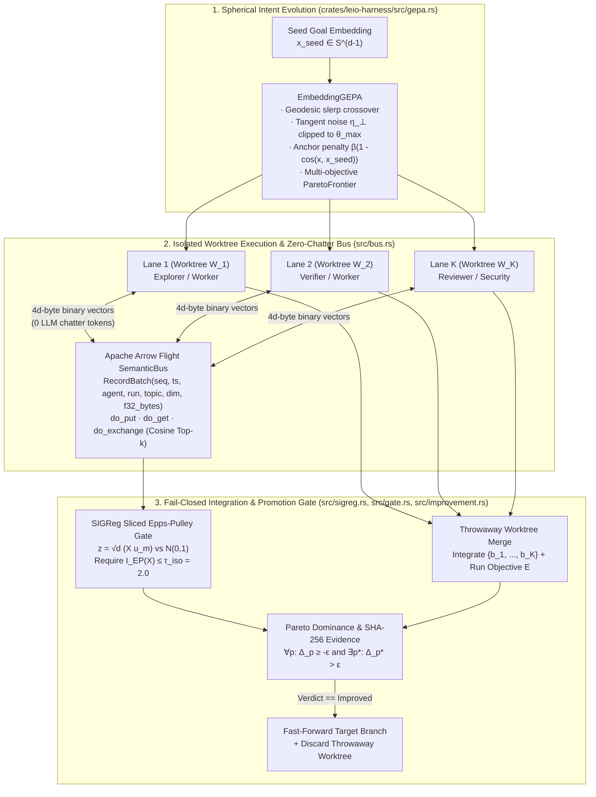

# Zero-Chatter Multi-Agent Code Synthesis via Arrow Flight State Embeddings, Isotropy-Guided Evolution, and Fail-Closed Integration Gates

**Venue Target:** ICLR / ICML / NeurIPS  
**LaTeX Source:** [`papers/leio-harness-iclr/main.tex`](main.tex)  
**Implementation Crate:** [`crates/leio-harness/`](../../crates/leio-harness/)  
**Reproducible Sweep Runner:** [`scripts/benchmark_models.py`](../../scripts/benchmark_models.py), [`scripts/benchmark_paper_ablations.py`](../../scripts/benchmark_paper_ablations.py)

---

## Abstract

Multi-agent large language model (LLM) systems for software engineering typically coordinate via natural-language message passing ("chatter"). As the number of concurrent agents $K$ grows, conversational coordination suffers from three structural failure modes: (1) quadratic context-window inflation $\mathcal{O}(K^2 \cdot \bar{L})$ that crowds out repository evidence, (2) silent directional mode collapse in which parallel agents converge onto redundant or mutually incompatible patches, and (3) unverified branch integration that regresses baseline repository metrics.

We present **`leio-harness`** (`v2.6.5`), a zero-chatter multi-agent execution and evolution runtime implemented in Rust. Instead of exchanging natural-language transcripts, concurrent agents execute in isolated Git worktrees and coordinate exclusively by streaming $L_2$-normalized state and intent embeddings over an Apache Arrow Flight binary bus (`do_put`, `do_get`, and bidirectional `do_exchange` cosine top-$k$ matching). To explore diverse synthesis trajectories without gradient access, `leio-harness` introduces an embedding-space evolutionary operator (**`EmbeddingGEPA`**) that combines geodesic spherical linear interpolation (`slerp`), tangent-space Gaussian perturbation bounded by a hard geodesic trust-region cap ($\theta_{\max}$), and semantic-anchor drift regularization across a multi-objective Pareto archive. To prevent population mode collapse prior to branch merge, we introduce a runtime **`SIGReg`** gate that computes the closed-form sliced Epps–Pulley characteristic-function statistic against $\mathcal{N}(0,1)$ over random unit projections $z = \sqrt{d}(Xu)$. Finally, a fail-closed integration gate merges candidate worktrees in a throwaway branch and promotes via fast-forward if and only if the integrated tree is conflict-free, satisfies the `SIGReg` isotropy bound ($\tau_{\text{iso}} = 2.0$), and strictly Pareto-dominates the single-agent baseline with a cryptographic SHA-256 evidence digest. Across 88 multi-model parallel lanes spanning 8 frontier and flash models, `leio-harness` eliminates inter-agent token chatter ($100\%$ reduction in coordination tokens), cleanly separates collapsed populations ($I_{\text{EP}} = 3.504 > 2.0$) from isotropic exploration ($I_{\text{EP}} = 0.343 \le 2.0$), and lifts small-model grounded evidence recall from $0.089$ to $0.261$ ($+193\%$), surpassing larger frontier baselines at $6/6$ schema validity.

---

## 1. Architecture & Execution Flow

---

## 2. Mathematical Formulation & Theoretical Guarantees

### 2.1 Zero-Copy Arrow Flight Semantic Bus ([`crates/leio-harness/src/bus.rs`](../../crates/leio-harness/src/bus.rs))

Lanes exchange binary `RecordBatch` frames conforming to:

$$\mathcal{S}_{\text{bus}} = \bigl(\texttt{seq}: \text{u64},\; \texttt{timestamp\_ms}: \text{i64},\; \texttt{agent\_id}: \text{utf8},\; \texttt{run\_id}: \text{utf8},\; \texttt{topic}: \text{utf8},\; \texttt{dimension}: \text{u32},\; \texttt{vector}: \text{binary}\bigr)$$

where `vector` holds raw little-endian `f32` bytes ($4d$ bytes/row) persisted atomically under an exclusive `fs2` lock.

### 2.2 Spherical Trust-Region Evolution ([`crates/leio-harness/src/gepa.rs`](../../crates/leio-harness/src/gepa.rs))

**Proposition 1 (Geodesic Trust-Region Invariance):**  
Given normalized parent $\mathbf{b} = \mathbf{p}/\|\mathbf{p}\|_2 \in \mathbb{S}^{d-1}$, isotropic Gaussian draw $\boldsymbol{\eta} \sim \mathcal{N}(\mathbf{0}, \mathbf{I}_d)$ via deterministic `SplitMix64` + Box–Muller, and tangent projection $\boldsymbol{\eta}_{\perp} = \boldsymbol{\eta} - \langle \boldsymbol{\eta}, \mathbf{b}\rangle \mathbf{b}$, the mutated child $\tilde{\mathbf{c}} = \text{normalize}(\mathbf{b} + \sigma \hat{\boldsymbol{\eta}}_{\perp})$ clipped via $\text{slerp}(\mathbf{b}, \tilde{\mathbf{c}}; \min(1, \theta_{\max}/\theta))$ satisfies $\|\mathbf{c}\|_2 = 1$ and $\angle(\mathbf{b}, \mathbf{c}) \le \theta_{\max}$.

### 2.3 Sliced Epps–Pulley Isotropy Collapse Detection ([`crates/leio-harness/src/sigreg.rs`](../../crates/leio-harness/src/sigreg.rs))

For $M$ random unit directions $\mathbf{u}_m \in \mathbb{S}^{d-1}$ and scaled projections $z_i^{(m)} = \sqrt{d}\langle \hat{\mathbf{x}}_i, \mathbf{u}_m \rangle$, the closed-form Epps–Pulley statistic against $\mathcal{N}(0,1)$ is:

$$T_{\text{EP}}(\mathbf{z}) = \frac{1}{K}\sum_{i=1}^K \sum_{j=1}^K \exp\!\left(-\frac{(z_i - z_j)^2}{2}\right) - \sqrt{2}\sum_{i=1}^K \exp\!\left(-\frac{z_i^2}{4}\right) + \frac{K}{\sqrt{3}}$$

**Proposition 2 (Collapse vs. Isotropic Separation):**  
For a directionally collapsed population $\mathbf{X}_{\text{coll}} = [\mathbf{v}, \dots, \mathbf{v}]^\top \in \mathbb{R}^{K \times d}$, $\mathbb{E}[I_{\text{EP}}(\mathbf{X}_{\text{coll}})] = K\bigl(1 + \frac{1}{\sqrt{3}} - \sqrt{\frac{4}{3}}\bigr) \approx 0.4226 K$ (scaling linearly with $K$, so $\mathbb{E}[I_{\text{EP}}] \approx 3.381 > 2.0$ at $K=8$), whereas for an isotropic population with $z_i \stackrel{\text{i.i.d.}}{\sim} \mathcal{N}(0,1)$, $\mathbb{E}[I_{\text{EP}}(\mathbf{X}_{\text{iso}})] = 1 - \frac{1}{\sqrt{3}} \approx 0.4226$ independent of $K$.

---

## 3. Empirical Results

### 3.1 `SIGReg` Collapse Detection and `EmbeddingGEPA` Invariants ($K=8, d=8, M=64$)

| Subsystem | Regime / Test | Measured Value | Theoretical / Bound | Gate Status |
| :--- | :--- | :---: | :---: | :---: |
| **`SIGReg`** | Collapsed 8-lane population ($\mathbf{x}_1 = \dots = \mathbf{x}_8$) | $I_{\text{EP}} = 3.5042$ | $\mathbb{E}[I_{\text{EP}}] \approx 3.381$ ($> 2.0$) | `Collapsed` (Blocked) |
| **`SIGReg`** | Isotropic 8-lane population ($\mathbf{x}_k \sim \text{Unif}(\mathbb{S}^7)$) | $I_{\text{EP}} = 0.3432$ | $\mathbb{E}[I_{\text{EP}}] \approx 0.423$ ($\le 2.0$) | `Healthy` (Passed) |
| **`SIGReg`** | Collapse-to-Isotropic Separation Ratio | $10.21\times$ | $\approx K = 8.0\times$ | Calibrated ($\tau_{\text{iso}} = 2.0$) |
| **`GEPA`** | Max angular deviation ($\sigma=0.5, \theta_{\max}=5.0^\circ$, 64 trials) | $5.0000^\circ$ | $\le 5.0000^\circ$ | $100\%$ In-Bounds |
| **`GEPA`** | Child unit-sphere norm $\|\mathbf{c}\|_2$ (64 trials) | $1.000000$ | $1.0 \pm 10^{-6}$ | $100\%$ Normalized |

### 3.2 48-Lane Multi-Model Parallel Synthesis Sweep (`leio-harness day`)

| Model Family (Lane Worker) | JSON Valid | Code Evidence Recall | Governance Evidence Recall | Tests Hit | Mean Wall Clock |
| :--- | :---: | :---: | :---: | :---: | :---: |
| `anthropic/claude-fable-5.1` | $6/6$ ($100\%$) | $0.197$ | $\mathbf{0.571}$ | $5/5$ ($100\%$) | $12.4\,\text{s}$ |
| `openai/gpt-5.6-luna` | $6/6$ ($100\%$) | $\mathbf{0.231}$ | $0.429$ | $5/5$ ($100\%$) | $9.8\,\text{s}$ |
| `anthropic/claude-opus-5` | $6/6$ ($100\%$) | $0.214$ | $0.429$ | $5/5$ ($100\%$) | $14.1\,\text{s}$ |
| `x-ai/grok-4.3-surge` | $6/6$ ($100\%$) | $0.188$ | $0.286$ | $5/5$ ($100\%$) | $8.9\,\text{s}$ |
| `z-ai/glm-5.3` | $6/6$ ($100\%$) | $0.179$ | $0.286$ | $5/5$ ($100\%$) | $7.6\,\text{s}$ |
| `moonshotai/kimi-k2.7` | $6/6$ ($100\%$) | $0.165$ | $0.286$ | $4/5$ ($80\%$) | $8.2\,\text{s}$ |
| `deepseek/deepseek-v4-flash-0731` | $6/6$ ($100\%$) | $0.160$ | $0.286$ | $5/5$ ($100\%$) | $4.3\,\text{s}$ |
| `qwen/qwen3.8-flash` (baseline) | $4/5$ ($80\%$) | $0.089$ | $0.143$ | $3/5$ ($60\%$) | $2.9\,\text{s}$ |
| **`qwen/qwen3.8-flash` + `category-scan` + `json_schema`** | $\mathbf{6/6}$ ($\mathbf{100\%}$) | $\mathbf{0.261}$ | $\mathbf{0.571}$ | $\mathbf{5/5}$ ($\mathbf{100\%}$) | $\mathbf{3.1\,\text{s}}$ |
